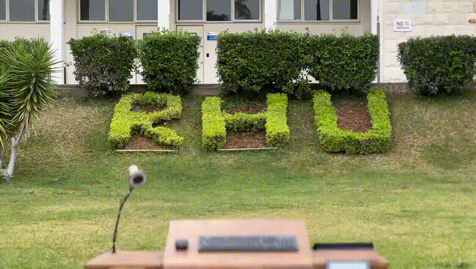

# 🎓 Smart Interactive Desk - Senior Graduation Project

> **An IoT-Enabled, AI-Powered Smart Desk System with Multi-Device Communication, Posture Correction, and Interactive Learning Features**

[]()
[]()
[]()

---

## 🤖 Smart Interactive Desk

<div align="center">



**Watch the Smart Interactive Desk in action!**  
*Experience automatic height adjustment, posture correction, multi-interface control, and seamless IoT connectivity in this cinematic demonstration.*

</div>

---

## 🎥 Demo Video

<div align="center">

[](https://youtu.be/5TPmpPc6rjY)

**Click the image above to watch the full demonstration video on YouTube**

</div>

---

## 📋 Table of Contents

- [Project Overview](#-project-overview)
- [Team Members](#-team-members)
- [Key Features](#-key-features)
- [System Architecture](#-system-architecture)
- [Technology Stack](#-technology-stack)
- [Hardware Components](#-hardware-components)
- [Installation & Setup](#-installation--setup)
- [Project Structure](#-project-structure)
- [Usage](#-usage)
- [Project Resources](#-project-resources)
- [Contributing](#-contributing)

---

## 🎯 Project Overview

The **Smart Interactive Desk (BEMO)** is a comprehensive IoT-enabled workstation system designed for modern classrooms, offices, and collaborative learning environments. This senior graduation project integrates **hardware control**, **computer vision**, **artificial intelligence**, **network communication**, and **ergonomic assistance** into a unified, intelligent desk system.

### What Makes This Project Special?

- 🤖 **Full-Stack IoT System**: Complete integration from hardware firmware to web interfaces
- 🌐 **Multi-Device Communication**: Desks can communicate with each other across classrooms via WiFi
- 📱 **Multiple Control Interfaces**: Web app, desktop GUI, Bluetooth controller, and manual buttons
- 🧠 **AI-Powered Features**: Handwriting recognition using Microsoft TrOCR, computer vision for posture monitoring
- 🏃 **Automatic Posture Correction**: Real-time sensor feedback with motorized height and tilt adjustment
- 📊 **Comprehensive Analytics**: Usage statistics, posture tracking, and data logging
- 🎨 **Modern UI/UX**: Custom-built GUI with theming support and responsive web interface

---

## 👥 Team Members

- **Rami Kronbi**
- **Bassam Kousa**
- **Ali Daaboul**
- **Mohamad Berjawi**
- **Mohamad Hariri**

---

## ✨ Key Features

### 🏃 Ergonomic & Health Features

- **Motorized Standing Desk**
  - Automatic height adjustment (80-100cm range)
  - Tilt adjustment for optimal viewing angle
  - Safety limits and position feedback
  - Real-time height and angle display on LCD

- **Automatic Posture Correction**
  - Ultrasonic sensors for height measurement
  - ToF (Time-of-Flight) sensors for tilt detection
  - Kalman filtering for sensor data smoothing
  - Real-time posture monitoring and alerts
  - Automatic desk adjustment based on user position

### 🌐 Connectivity & Communication

- **WiFi Connectivity**
  - Network-enabled communication between desks
  - Cross-classroom desk-to-desk messaging
  - Real-time status synchronization

- **Bluetooth Support**
  - PS4 controller integration for desk control
  - Wireless control interface

- **Web-Based Control**
  - Responsive web interface accessible from any device
  - Real-time Socket.io communication
  - RESTful API for desk control
  - Multi-user support with user database

- **AirDrop-like File Sharing**
  - Network-based file transfer between desks
  - Seamless document sharing in classroom environments

### 🎨 Interactive Features

- **Desktop GUI Application**
  - Modern Tkinter-based interface
  - Customizable themes and styling
  - Multi-page navigation (Home, Notes, Music, Lists, Alarm, Settings)
  - Real-time desk status display

- **Notes & AI Integration**
  - Handwriting capture via webcam
  - AI-powered text recognition using Microsoft TrOCR
  - Image segmentation and processing
  - Digital note-taking and storage

- **Music Player**
  - Built-in audio playback
  - Play, pause, stop controls
  - File browser integration

- **Task Management**
  - To-do lists and reminders
  - Alarm system with notifications
  - User-specific task storage

### 🔧 Hardware Control

- **Dual Motor System**
  - Height adjustment motor (PWM controlled)
  - Tilt adjustment motors (dual motor control)
  - Safety interlocks and position limits

- **Sensor Array**
  - Ultrasonic sensors (HC-SR04) for height measurement
  - VL53L0X ToF sensors for precise distance measurement
  - Manual control buttons with interrupt handling

- **Display System**
  - Nokia 5110 LCD display (84x48 pixels)
  - Real-time height and tilt angle display
  - Status messages and welcome screen

---

## 🏗️ System Architecture

```
┌─────────────────────────────────────────────────────────────┐
│                    Smart Interactive Desk                    │
│                      System Architecture                     │
└─────────────────────────────────────────────────────────────┘

┌──────────────┐      ┌──────────────┐      ┌──────────────┐
│   Web App    │      │  Desktop GUI │      │   Bluetooth   │
│  (Node.js)   │◄────►│   (Python)   │◄────►│   Controller  │
│              │      │              │      │               │
└──────┬───────┘      └──────┬───────┘      └───────────────┘
       │                     │
       │  Socket.io / HTTP   │
       │                     │
       └──────────┬──────────┘
                  │
       ┌──────────▼──────────┐
       │   Flask API Bridge  │
       │    (Python/Flask)   │
       └──────────┬──────────┘
                  │
                  │ Serial/USB
                  │
       ┌──────────▼──────────┐
       │   ESP32/Arduino    │
       │   Microcontroller   │
       └──────────┬──────────┘
                  │
       ┌──────────┼──────────┐
       │          │          │
   ┌───▼───┐  ┌───▼───┐  ┌───▼───┐
   │Motors │  │Sensors│  │Display│
   └───────┘  └───────┘  └───────┘
```

### Communication Flow

1. **User Input** → Web App / GUI / Bluetooth Controller
2. **Command Processing** → Node.js Server / Python GUI
3. **API Bridge** → Flask API (localhost:5001)
4. **Serial Communication** → ESP32/Arduino (115200 baud)
5. **Hardware Control** → Motors, Sensors, Display
6. **Feedback Loop** → Sensor data → Display → User Interface

---

## 💻 Technology Stack

### Backend & Firmware

- **Python 3.x**
  - Flask (REST API)
  - Tkinter (Desktop GUI)
  - PySerial (Serial communication)
  - OpenCV (Computer vision)
  - Pygame (Audio playback)
  - Transformers (AI/ML - TrOCR)
  - NumPy (Image processing)
  - PyYAML (Configuration)

- **Node.js**
  - Express.js (Web server)
  - Socket.io (Real-time communication)
  - CORS (Cross-origin support)

- **Arduino/ESP32 (C++)**
  - Hardware abstraction
  - Motor control libraries
  - Sensor libraries (NewPing, Adafruit_VL53L0X)
  - LCD display drivers (Adafruit_PCD8544)

### Frontend

- **HTML/CSS/JavaScript**
  - Responsive web interface
  - Real-time updates via Socket.io
  - Modern UI components

- **Tkinter (Python)**
  - Custom GUI framework
  - Theming system
  - Multi-page navigation

### AI/ML

- **Microsoft TrOCR** (Transformer-based OCR)
  - Handwritten text recognition
  - Image-to-text conversion

- **OpenCV**
  - Image segmentation
  - Computer vision processing
  - Webcam integration

---

## 🔌 Hardware Components

### Microcontroller
- **ESP32** or **Arduino Mega** (primary controller)

### Actuators
- **2x DC Motors** (height adjustment)
- **2x DC Motors** (tilt adjustment)
- **Motor drivers** (H-bridge configuration)

### Sensors
- **2x HC-SR04 Ultrasonic Sensors** (height and tilt measurement)
- **2x VL53L0X Time-of-Flight Sensors** (precise distance measurement)
- **4x Manual Control Buttons** (up, down, tilt up, tilt down)

### Display
- **Nokia 5110 LCD** (84x48 pixel monochrome display)

### Communication
- **WiFi Module** (ESP32 built-in or external)
- **Bluetooth Module** (for PS4 controller)

---

## 🚀 Installation & Setup

### Prerequisites

- Python 3.8+
- Node.js 14+
- Arduino IDE (for firmware upload)
- USB-to-Serial driver (for ESP32/Arduino communication)

### Step 1: Clone the Repository

```bash
git clone https://github.com/Kronbii/smart-interactive-desk.git
cd smart-interactive-desk
```

### Step 2: Install Python Dependencies

```bash
pip install -r requirements
```

**Note**: The `requirements` file contains:
- serial / pyserial
- opencv-python
- python-box
- tkinter (usually pre-installed)
- ttkinter
- numpy

**Additional dependencies** (install separately):
```bash
pip install flask pygame transformers torch pillow pyyaml
```

### Step 3: Install Node.js Dependencies

```bash
cd model/web-app
npm install
```

### Step 4: Configure Serial Port

Edit `model/config.yaml` or `config.yaml` to set your serial port:

```yaml
serial:
  port1: "/dev/ttyUSB0"  # Linux
  # port1: "COM3"        # Windows
  baudrate: 115200
  timeout: 1
```

### Step 5: Upload Firmware

1. Open `model/esp/esp.ino` in Arduino IDE
2. Select your board (ESP32 or Arduino Mega)
3. Select the correct COM port
4. Upload the firmware

### Step 6: Launch the System

**Option A: Using Launch Script**
```bash
cd model
chmod +x launch.sh
./launch.sh
```

**Option B: Manual Launch**
```bash
# Terminal 1: Start Node.js web server
cd model/web-app
npm start

# Terminal 2: Start Python GUI
cd model
python3 -m gui.main
```

### Step 7: Access the Web Interface

Open your browser and navigate to:
- **Web Interface**: `http://localhost:3000` (or your local IP)
- **Desktop GUI**: Launches automatically when running `gui.main`

---

## 📁 Project Structure

```
smart-interactive-desk/
│
├── model/                          # ✅ Production code (use this)
│   ├── esp/                        # ESP32/Arduino firmware
│   │   ├── esp.ino                 # Main firmware code
│   │   └── bemo.h                  # Hardware definitions & classes
│   │
│   ├── gui/                        # Desktop GUI application
│   │   ├── main.py                 # GUI entry point & Flask API
│   │   ├── home.py                 # Home page with controls
│   │   ├── notes.py                # Notes & AI features
│   │   ├── music.py                # Music player
│   │   ├── lists.py                # Task management
│   │   ├── alarm.py                # Alarm system
│   │   ├── setting.py              # Settings page
│   │   ├── control.py              # Desk control interface
│   │   ├── web.py                  # Web integration
│   │   └── icons/                  # GUI icons
│   │
│   ├── notes/                      # AI & Computer Vision
│   │   ├── ai.py                   # TrOCR handwriting recognition
│   │   ├── segment.py              # Image segmentation
│   │   └── notes.py                # Notes processing
│   │
│   ├── web-app/                    # Web interface
│   │   ├── server.js               # Node.js/Express server
│   │   ├── public/
│   │   │   ├── index.html          # Web UI
│   │   │   ├── script.js           # Client-side logic
│   │   │   └── styles.css          # Styling
│   │   └── package.json            # Node dependencies
│   │
│   ├── config.yaml                 # Configuration file
│   ├── control.json                # Control state storage
│   ├── users.json                  # User database
│   └── launch.sh                   # Launch script
│
├── koubeisically/                  # ❌ Deprecated (early prototype)
│   └── src/                        # Old Python modules
│
├── bash-scripts/                    # Utility scripts
│   ├── bluetooth.sh                # Bluetooth setup
│   ├── run_pipeline.sh             # Pipeline execution
│   └── web.sh                      # Web server management
│
├── website/                         # Project website
│   ├── website.html                # Main page
│   ├── pages/                      # Additional pages
│   └── styles/                     # Website styling
│
├── readme/                          # Documentation
│   ├── install-node                # Node.js installation guide
│   ├── remove-sudo-passwd          # System setup
│   └── static-ip                   # Network configuration
│
├── user-database/                   # User data storage
│   └── users.json
│
├── config.yaml                     # Root configuration
├── requirements                     # Python dependencies
└── README.md                        # This file
```

### Important Notes

- ✅ **`model/`** - This is the **production-ready** code. Use this directory for all development and deployment.
- ❌ **`koubeisically/`** - Deprecated early prototype. Kept for reference only.
- 📝 **Configuration** - Edit `model/config.yaml` for serial ports, themes, and system settings.

---

## 🎮 Usage

### Web Interface

1. **Start the servers** (see Installation)
2. **Open browser** to `http://localhost:3000`
3. **Control the desk** using the web interface buttons
4. **Monitor status** in real-time via Socket.io updates

### Desktop GUI

1. **Launch** `python3 -m gui.main`
2. **Navigate** using the sidebar menu
3. **Control desk** from the Home page
4. **Access features**:
   - 📝 **Notes**: Capture and recognize handwriting
   - 🎵 **Music**: Play audio files
   - ✅ **Lists**: Manage tasks
   - ⏰ **Alarm**: Set reminders
   - ⚙️ **Settings**: Configure preferences

### Bluetooth Controller (PS4)

1. **Pair** your PS4 controller via Bluetooth
2. **Run** the controller script (if available)
3. **Use arrow keys** to control desk height and tilt

### Manual Control

- **Physical buttons** on the desk allow direct control
- **Safety limits** prevent over-extension
- **LCD display** shows current height and tilt angle

---

## 📚 Project Resources

For detailed documentation, reports, and project resources, visit:

**[Project Resources - Google Drive](https://drive.google.com/drive/folders/1InH4OToC-3ZCmpd2p8zu-zYlxD98OoeB?usp=drive_link)**

This includes:
- Project proposal and design documents
- Technical specifications
- User manuals
- Presentation materials
- Research papers and references

---

## 🤝 Contributing

This is a senior graduation project. While contributions are welcome, please note:

1. **Main branch** contains the production code in `model/`
2. **Documentation** improvements are always appreciated
3. **Bug reports** should include:
   - Hardware configuration
   - Software versions
   - Error logs
   - Steps to reproduce

---

## 📊 Project Statistics

- **Lines of Code**: 10,000+ (across all components)
- **Languages**: Python, JavaScript, C++ (Arduino), HTML/CSS
- **Components**: 15+ major modules
- **Hardware Interfaces**: 4+ (Serial, WiFi, Bluetooth, USB)
- **AI/ML Models**: 1 (Microsoft TrOCR)
- **Development Time**: Full academic year

---

## 🎓 Academic Context

This project was developed as a **Senior Graduation Project** demonstrating:
- Full-stack development capabilities
- IoT system integration
- Hardware-software interfacing
- AI/ML implementation
- Network programming
- Real-time systems
- User interface design

---

## 📄 License

This project is developed for academic purposes. All rights reserved by the project team.

---

## 🙏 Acknowledgments

- **Microsoft** for TrOCR model
- **Adafruit** for sensor libraries
- **OpenCV** community
- **Arduino** and **ESP32** communities
- Faculty advisors and reviewers

---

## 📞 Contact

For questions or inquiries about this project, please contact the team members or refer to the project resources link above.

---

**Built with ❤️ by the Smart Interactive Desk Team**

*Last Updated: 2024*
