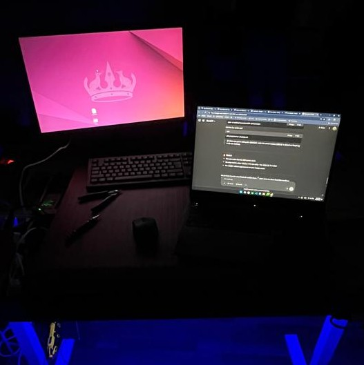
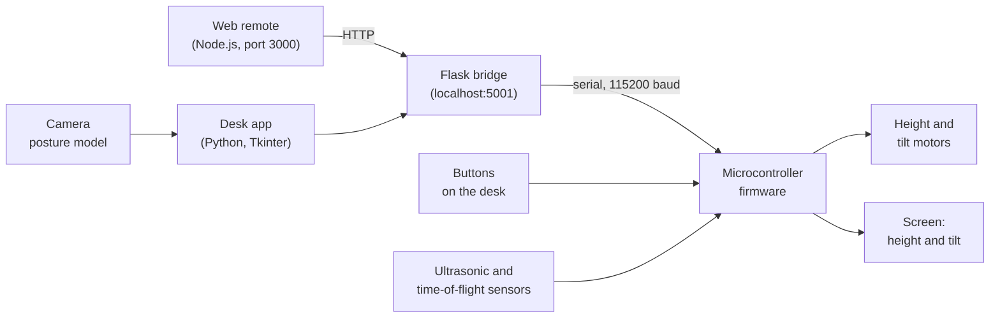

# Smart Interactive Desk (BEMO)

A posture-aware classroom desk: a camera watches how you sit, and motors set the desk's height and tilt to match.


[](https://youtu.be/5TPmpPc6rjY)

*The prototype. Click the photo for the full demo video.*

## What it is

BEMO was our senior graduation project at Rafik Hariri University (RHU), supervised by Prof. Ahmad Kubeissi. I led a team of five, and I worked on everything except the hardware design: the posture model, the sensors, the control, and the software. It won Best Graduating Project from the RHU Engineering Jury in 2025.

The idea is a desk that closes a physical loop between vision, control and motion. A camera estimates how someone is sitting, software decides whether the posture has drifted, and motors change the work surface. That loop is why a posture model can't be treated as an isolated prediction. Camera placement changes the geometry the model sees, moving the desk changes the camera's view, and a false correction can be distracting or unsafe. So the control side needs limits, slow transitions and a manual override.

Beyond the posture loop, the desk app also captures handwritten notes, plays music, keeps to-do lists and alarms, and has a web remote you open from a phone.

## Highlights

| | |
| --- | --- |
| Award | Best Graduating Project, RHU Engineering Jury, 2025 |
| Posture | a camera-based posture model |
| Desk sensing | ultrasonic and time-of-flight sensors measure the desk's own height and tilt |
| Motion | motorized height (kept between 80 and 100 cm in the firmware) and tilt |
| Control | desk app, web remote, PS4 controller, and four buttons on the desk |
| Handwriting | captured from a webcam and read with Microsoft TrOCR |

## How it works



1. **Observe.** A desk-mounted camera estimates posture. Posture comes from the camera model, not from the other sensors.
2. **Decide.** The control applies dead bands, mechanical limits and slow transitions before acting. On the wire, every way of moving the desk ends up as a short command to the microcontroller: up, down, tilt up, tilt down, stop.
3. **Move.** The firmware drives the height and tilt motors. Ultrasonic and time-of-flight sensors measure the desk itself, so it stops at its height limits and moves safely. The buttons on the desk always take priority over remote commands, and pressing up and down together resets the controller.
4. **Signal.** A small screen on the desk shows the current height and tilt, and the desk app has a dashboard for longer-term patterns.

The software side is three pieces. The desk app (`model/gui/`) is a Tkinter interface with Home, Notes, Music, Lists, Alarm and Settings pages; it also runs a small Flask bridge on `localhost:5001` that forwards commands to the microcontroller over serial. The web remote (`model/web-app/`) is an Express and Socket.io server that the app can launch from its Home page, with a QR code for a phone to join. The firmware (`model/esp/`) reads the buttons and sensors, drives the motors and updates the screen.

## Quick start

You need the desk hardware for the motors and sensors to do anything. Without it the app still opens and logs a serial error.

**1. Firmware.** Open `model/esp/esp.ino` in the Arduino IDE, install the libraries it includes (Adafruit GFX, Adafruit PCD8544, Adafruit VL53L0X, NewPing), and upload it to the board. See the note in [Limits](#limits) before compiling.

**2. Desk app and bridge.** With Python 3:

```bash
pip install pyserial opencv-python python-box pyyaml numpy pillow pygame flask
pip install transformers torch   # only for handwriting recognition
```

Set the serial port in `model/config.yaml` (it defaults to `/dev/ttyACM0`, then tries `/dev/ttyACM1`), then start the app from the `model` folder:

```bash
cd model
python3 -m gui.main
```

**3. Web remote.** The app starts it from its Home page, or you can run it yourself:

```bash
cd model/web-app
npm install
npm install socket.io   # server.js needs it, and package.json doesn't list it
node server.js          # then open http://<the desk's IP>:3000
```

## Repository layout

```
.
├── model/            the working system
│   ├── esp/          microcontroller firmware (esp.ino, bemo.h)
│   ├── gui/          desk app and Flask bridge (entry point: python3 -m gui.main)
│   ├── notes/        handwriting capture and TrOCR recognition
│   ├── web-app/      Node.js web remote
│   └── config.yaml   theme, serial port and segmentation settings
├── koubeisically/    an early prototype, kept for reference
├── bash-scripts/     Bluetooth, web-server and pipeline helpers
├── website/          the project's website
├── readme/           setup notes (Node.js install, static IP)
├── images/           demo media
└── docs/media/       images for this README
```

## Limits

- It is a prototype: the posture model was tuned on our own team, not on a classroom of students.
- The posture model's code isn't in this repository. What's here is the desk side: the firmware, the app and bridge, the web remote and the notes feature.
- `model/esp/esp.ino` still contains unresolved merge-conflict markers. Keep the "Updated upstream" side before compiling; it is the version with the screen and both sonar sensors.
- `model/launch.sh` and the scripts in `bash-scripts/` use paths from the machines we built on, so adjust them before using them.
- `requirements` lists `tkinter` and `ttkinter`, which don't install from pip; use the `pip install` line above.

## Links

- Project page: [ramikronbi.com/projects/posture-aware-classroom-desk](https://ramikronbi.com/projects/posture-aware-classroom-desk)
- Write-up: [Connecting posture estimation to a motorized desk](https://ramikronbi.com/writing/connecting-posture-estimation-to-a-motorized-desk)
- Demo video: [youtu.be/5TPmpPc6rjY](https://youtu.be/5TPmpPc6rjY)
- Project documents: [Google Drive](https://drive.google.com/drive/folders/1InH4OToC-3ZCmpd2p8zu-zYlxD98OoeB?usp=drive_link)

## Team

Senior graduation project at Rafik Hariri University, supervised by Prof. Ahmad Kubeissi.

- Rami Kronbi (team lead)
- Bassam Kousa
- Ali Daaboul
- Mohamad Berjawi
- Mohamad Hariri

Built by Rami Kronbi and the BEMO team. [ramikronbi.com](https://ramikronbi.com)
